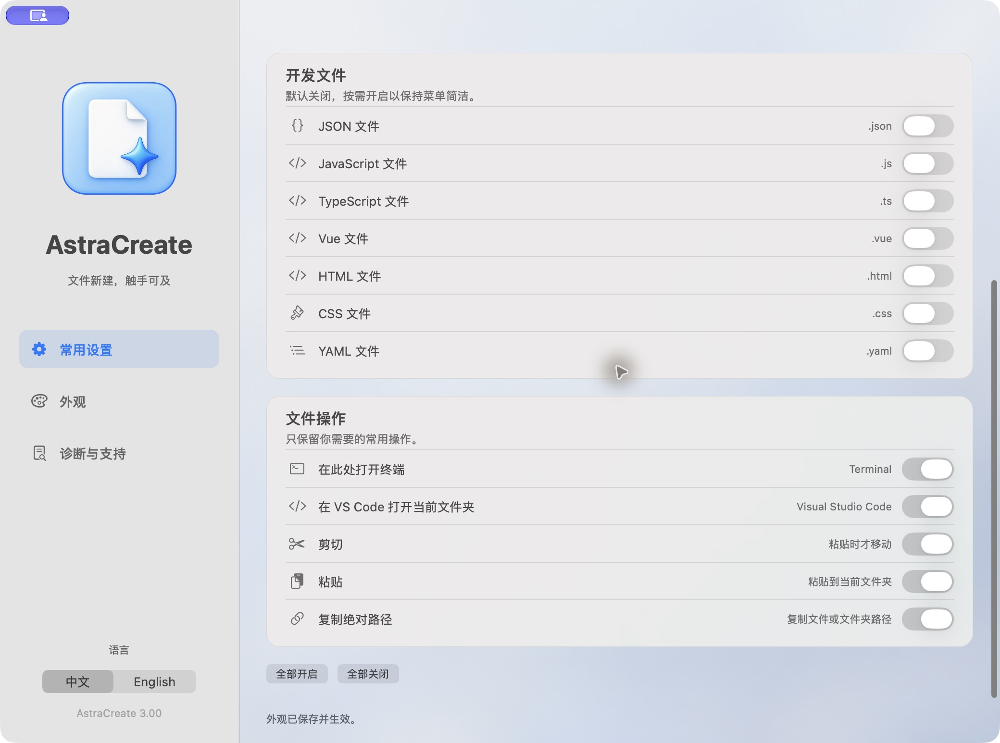

# Quick start

[Guide home](../README.md) · [中文](../zh/quick-start.md)

1. Download the PKG from [stable releases](https://github.com/WECLwhy/AstraCreate/releases/latest). Requires macOS 13+ and Apple Silicon.
2. Authorize and complete macOS Installer, then open `/Applications/AstraCreate.app`.
3. Enable the New Common Files Finder extension in System Settings. See [troubleshooting](finder-troubleshooting.md) if menus are missing.
4. In a regular local folder, right-click the background → New File, or click AstraCreate in the Finder toolbar.
5. New developer formats default to off. Enable each in General → Developer Files.

Settings save automatically and apply when you reopen the menu. The sidebar contains General, Appearance and Diagnostics & Support. See [installation](installation.md), [compatibility](../compatibility.md) and [formats](features.md).
