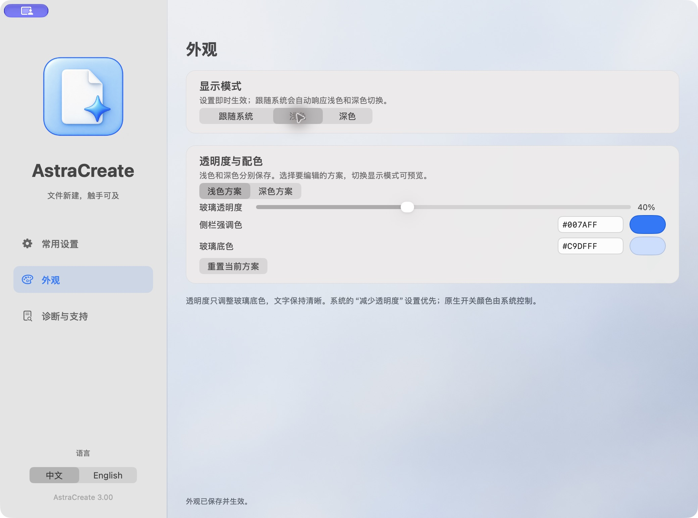
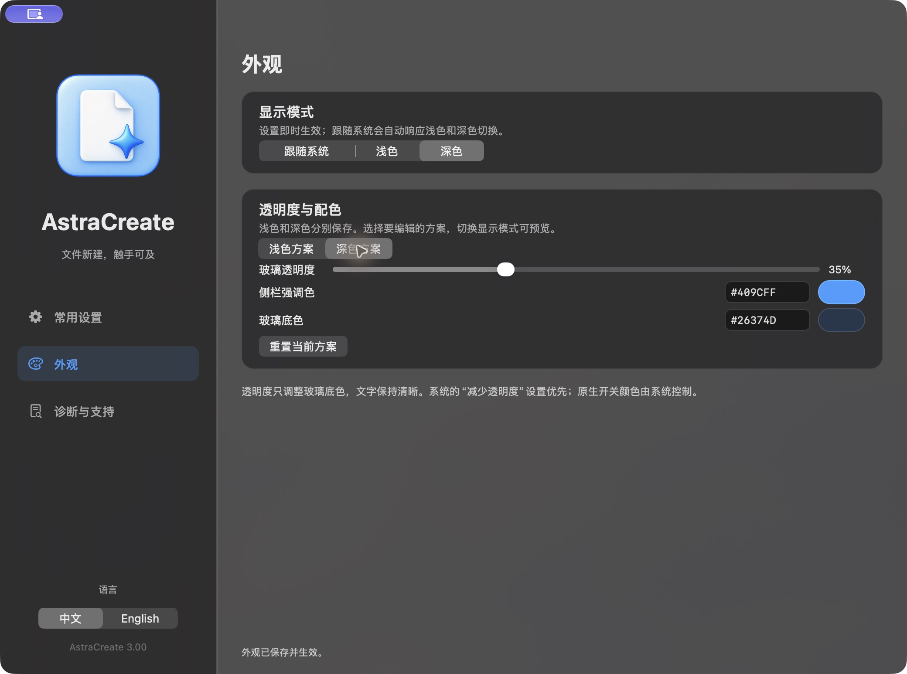

# 外观与个性化

[文档首页](../README.md) · [English](../en/appearance.md)

1. 在左侧选择“外观”，选择跟随系统、浅色或深色。
2. 选择要编辑的浅色/深色方案，两套独立保存；切换显示模式可预览。
3. 玻璃透明度可调 0–100%，文字保持语义颜色。它调整面板底色透明度，不是整窗或文字透明度。
4. 侧栏强调色和玻璃底色可用系统色板或 `#RRGGBB` 输入；无效 HEX 不保存。
5. “重置当前方案”只重置当前编辑的方案；其他偏好保留。

设置即时生效并自动保存。系统的“减少透明度”优先，原生开关颜色由系统控制；磨砂效果也随桌面背景和系统版本变化。中文/English 语言控件固定在侧栏下方。
